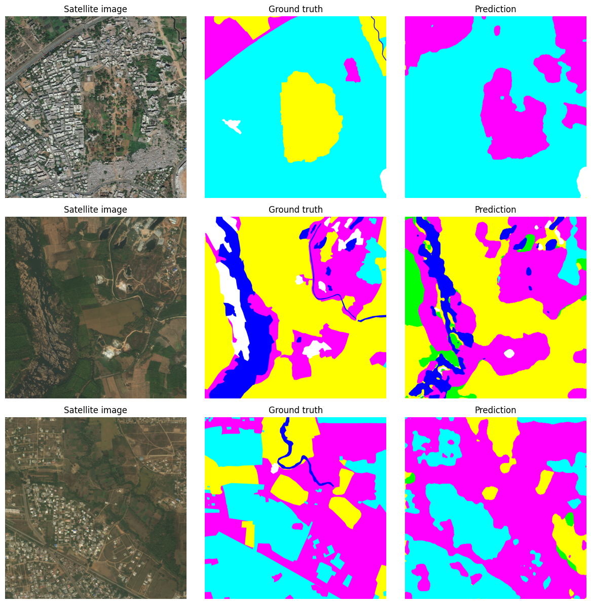
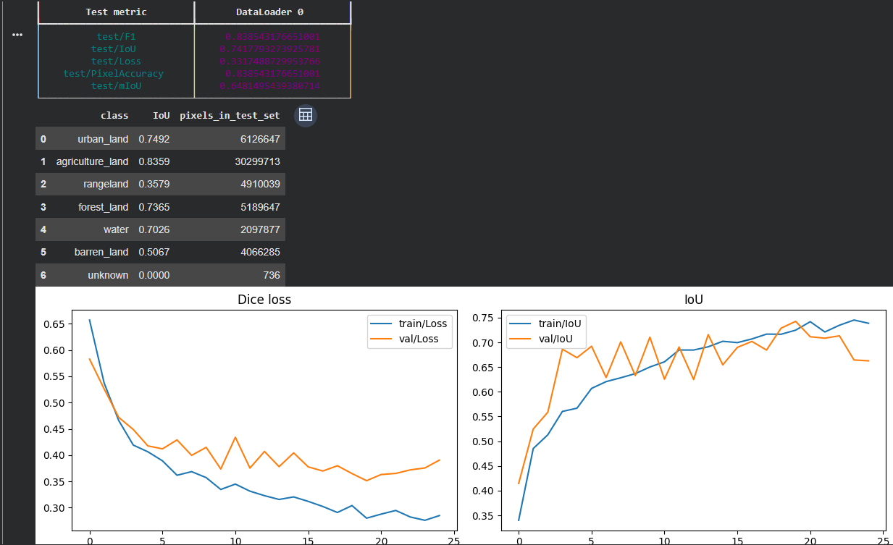

# Land-Cover Segmentation with U-Net++ (DeepGlobe)

Pixel-level land-cover mapping of satellite images into urban, agriculture, rangeland, forest, water and barren land. The model is a U-Net++ with an ImageNet-pretrained RegNetY-120 encoder, fine-tuned on the DeepGlobe Land Cover dataset. A small Gradio app turns any uploaded satellite image into a color-coded map with the share of each class.



## Results

Evaluated on a held-out test set of **201 images** that the model never saw during training or model selection. The best checkpoint (epoch 19 by validation IoU) was used.

| Metric | Test score |
| --- | --- |
| **Pixel accuracy** | **83.9%** |
| **mIoU** (6 classes, "unknown" excluded) | **0.648** |
| IoU (micro, averaged per image) | 0.742 |
| Dice loss | 0.332 |

### Per-class IoU

| Class | IoU | Share of test pixels |
| --- | --- | --- |
| Agriculture | 0.836 | 57.5% |
| Urban | 0.749 | 11.6% |
| Forest | 0.737 | 9.8% |
| Water | 0.703 | 4.0% |
| Barren | 0.507 | 7.7% |
| Rangeland | 0.358 | 9.3% |
| Unknown | n/a | <0.01% |

**What the numbers show:**
- **Agriculture, urban, forest and water** are segmented well.
- **Rangeland is the hardest class.** It is visually close to agriculture and barren land. This matches the DeepGlobe challenge, where rangeland is a known weak class.
- **Pixel accuracy is driven by agriculture.** It covers more than half of all test pixels, which is why **mIoU** is the fairer summary metric.
- **"Unknown" is excluded from mIoU.** It covers only 736 test pixels and is not a real land-cover type.



## Method

### Data

- **Source:** [DeepGlobe Land Cover Classification Dataset (Kaggle)](https://www.kaggle.com/datasets/balraj98/deepglobe-land-cover-classification-dataset): 803 labelled RGB satellite tiles (2448 × 2448, 50 cm/pixel) with pixel-wise masks.
- **Classes:** urban, agriculture, rangeland, forest, water, barren, unknown. RGB masks are converted to class-index masks using `class_dict.csv`.
- **Split** (fixed seed, so every run uses the same test set):

  | Train | Validation | Test |
  | --- | --- | --- |
  | 481 | 121 | 201 |

### Preprocessing and augmentation

| | Training | Validation / test / app |
| --- | --- | --- |
| Resize | 512 × 512 | 512 × 512 |
| Random flips (horizontal, vertical) | ✓ | |
| Random brightness / contrast | ✓ | |
| Random zoom (scale 0.8–1.0) | ✓ | |
| ImageNet normalization | ✓ | ✓ |

Masks are resized with nearest-neighbour interpolation so class labels are never blended. Evaluation uses no random transforms, so results are repeatable.

### Model and training

| Setting | Value |
| --- | --- |
| Architecture | U-Net++ (`segmentation_models_pytorch`) |
| Encoder | RegNetY-120, ImageNet-pretrained |
| Loss | Multiclass Dice loss |
| Optimizer | AdamW, learning rate 1e-4 |
| Batch size | 3 |
| Precision | 16-bit mixed |
| Epochs | Up to 40; early stopping after 5 epochs without val-IoU improvement (stopped at epoch 24) |
| Model selection | Checkpoint with the highest validation IoU (epoch 19) |
| Hardware | Google Colab, NVIDIA T4 |
| Frameworks | PyTorch, PyTorch Lightning, Albumentations |

### Metrics

- **Pixel accuracy:** the share of pixels assigned the correct class.
- **IoU per class:** intersection over union, computed over the whole test set.
- **mIoU:** the mean of per-class IoU over the six real classes.
- **IoU (micro, per image):** the metric used for checkpointing and early stopping.

## Demo app

The last notebook cell starts a **Gradio** app. Upload a satellite image to get:
- a color-coded segmentation mask at the original resolution, and
- the percentage of the image covered by each class.

The app uses exactly the same preprocessing as evaluation.

## Run it

1. Download the [DeepGlobe dataset](https://www.kaggle.com/datasets/balraj98/deepglobe-land-cover-classification-dataset) and put it in Google Drive at `MyDrive/deepglobe/`. The folder must contain `class_dict.csv` and `train/`.
2. Open [`land_cover.ipynb`](land_cover.ipynb) in Google Colab and select a **GPU runtime**.
3. Run the cells in order:
   1. Install and mount Drive
   2. Settings and split
   3. Augmentations
   4. Data module
   5. Model
   6. Trainer
   7. Train
   8. Test and curves
   9. Prediction examples
   10. Gradio app

Training takes roughly 25 epochs on a T4. The best weights are saved to your Drive as `unetpp_regnety120_landcover_best.pt`, and `predictions.png` and `training_curves.png` are written to the working folder.

## Repository contents

```text
land_cover.ipynb        # Full pipeline: data, training, evaluation, visualizations, Gradio app
docs/predictions.png    # Example test predictions
docs/training_curves.png# Loss and IoU per epoch
```

## Limitations and next steps

- **Downsampled input.** Tiles are resized from 2448 px to 512 px, so thin roads, rivers and small buildings are lost. That is visible in the example predictions. Training on **random 512 px crops at full resolution** and predicting with a sliding window should recover fine detail.
- **Class imbalance.** Agriculture dominates, and rangeland stays weak. Next steps are to try a **Dice + cross-entropy loss with class weights** or focal loss.
- **Single run.** Results come from one training run and one split. Repeating with several seeds would give error bars.
- **Small dataset.** With only 481 training images, stronger augmentation (rotations, color jitter) may help generalization.

## Credits

- Dataset: Demir, I. et al. (2018). *DeepGlobe 2018: A Challenge to Parse the Earth through Satellite Images.* CVPR Workshops.
- Model library: [segmentation_models.pytorch](https://github.com/qubvel-org/segmentation_models.pytorch) by Pavel Iakubovskii.
- The pipeline was built starting from public DeepGlobe challenge notebooks and then reworked: fixed evaluation, best-checkpoint selection, per-class metrics and the demo app.

## License

Code is released under the [MIT License](LICENSE). The DeepGlobe dataset is subject to its own license terms.
